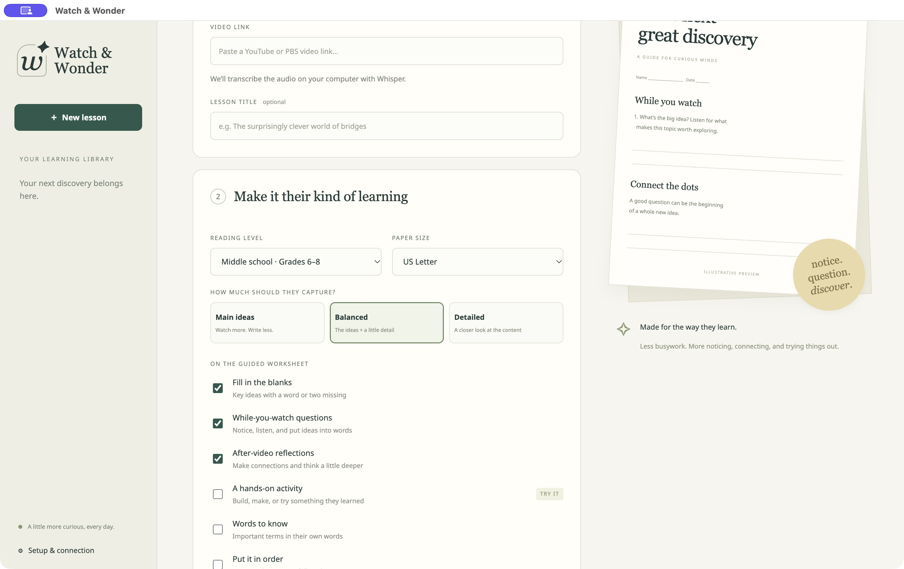

# Watch & Wonder

Turn a YouTube or PBS video—or a transcript or movie script you supply—into a printable learning experience. Built for parents, homeschoolers, teachers, and curious independent learners.

**Local Whisper transcription. Guided notes first. No browser extension. Worksheet generation uses an explicitly connected ChatGPT plan, with no API-key billing fallback.**



## What you can make

Choose any combination of:

- Fill-in-the-blank guided notes, with an optional word bank
- Questions to answer while watching
- Reflection questions for afterward
- A suggested hands-on application activity with materials and steps
- Vocabulary, sequencing, and sketch-and-explain sections
- Separate flashcards: a revealable study view, cut-and-fold PDF, and Anki-compatible TSV
- A separate practice quiz with interactive checking, a student PDF, and an answer-key PDF

Three density levels—**Main ideas**, **Balanced**, and **Detailed**—control how much to capture. Reading level is a separate choice, from early readers to adults. Pick US Letter or A4 paper and compact, standard, or extra writing space. Page count depends on source length and selected sections; density is a generation target rather than an exact question count.

[See a sample guided-notes PDF](docs/sample-guided-notes.pdf). This sample uses an original paper-bridge demonstration script, not a transcript of a real video.

## Quick start on macOS

Install [Node.js 22.9+](https://nodejs.org/) and [Homebrew](https://brew.sh/), then:

```sh
git clone https://github.com/TheCasey/watch-and-wonder.git
cd watch-and-wonder
brew install whisper.cpp ffmpeg yt-dlp
npm ci
npm run setup:local
npm run desktop
```

`setup:local` downloads and checksum-verifies the approximately 148 MB English `base.en` Whisper model. Models are not stored in Git. The Mac app uses your locally installed FFmpeg, whisper.cpp, and yt-dlp; it does not bundle those tools.

To build and install your own Mac app:

```sh
npm run build:mac -- --install
```

This creates `~/Applications/Watch & Wonder.app` and a Desktop shortcut. The locally built bundle includes Electron and, when present at build time, `models/ggml-base.en.bin`. The installer refuses to replace an existing app. Move a previous installation aside before installing a new build; your library stays in Application Support. Local builds use ad-hoc signing, not an Apple notarized installer.

## Browser / other platforms

With Node.js 22.9+, FFmpeg, whisper.cpp, and yt-dlp on your PATH:

```sh
npm ci
npm run setup:local
npm start
```

Open **http://127.0.0.1:3220**. This is a local web app; keep its server running while you work. No extension or hosted service is required. The server binds only to loopback. A browser can use Windows or Linux installations of the external tools; the packaged desktop build is currently provided as a macOS build script.

## Make your first lesson

1. Paste an **individual YouTube, PBS, or PBS LearningMedia HTTPS video URL**, or switch to **Transcript or script** and paste text/open a `.txt`, `.srt`, `.vtt`, or `.md` file.
2. Select reading level, worksheet density, sections, and optional separate study tools. Click **Review the transcript**. Video audio is downloaded temporarily and transcribed locally; pasting a script skips this stage.
3. Review the source. Correct names, transcription errors, or mismatched film dialogue using **Edit transcript**. Timed subtitles retain their real cues; plain scripts use paragraph references.
4. Open **Setup & connection → Continue with ChatGPT** and complete sign-in in your system browser. Choose a model from your connected account if desired.
5. Choose **Choose options & create** or **Customize & generate again**. Confirm your selections and create the worksheet. The transcript and learning preferences are sent to OpenAI at this point.
6. Review/edit questions and answers, then download **Guided notes PDF** and the separate **Answer key**. Flashcards and quiz have their own tabs and downloads.

**Saved versions** lets you restore an earlier worksheet, including its original transcript references and print settings. Edits save a new version. Updating a transcript does not overwrite an existing worksheet; generate again to apply source changes.

## Accuracy and long scripts

The actual supplied transcript is the factual source. Prompts forbid remembered movie details, unsupported visual descriptions, and invented timestamps. Requests use a required output schema so every generated item includes an existing source-segment ID and a source quote. Local validation then checks that each quote actually occurs in that segment. Fill-in-the-blank answers are also checked against their evidence, and quiz choices must contain the answer.

These checks verify source references; they do not prove that every generated interpretation or answer is correct. Review the worksheet and answer key before using them with children. Whisper can mishear words, especially names and technical terms. A script can also differ from the final film. Dialogue alone cannot establish details shown only on screen.

Long input is processed in ordered chunks without silently truncating the script. Validated chunk results are saved so **Retry saved progress** can reuse completed work after a rate limit or other failure. Detailed lessons use smaller source batches to keep individual drafts manageable. When a draft has missing evidence, an invalid quote, or malformed JSON, the app requests up to two corrected drafts automatically, then checks them against the same source. It never accepts an unverified item just to finish. Account, quota, and network failures stop without these automatic correction requests. Whole-lesson reflection and activity suggestions use verified excerpts collected across the chunks. Longer inputs can require several generation requests and more plan allowance. Inputs are limited to 900,000 characters, individual videos to four hours, and downloads to 2 GB. The model may omit selected question kinds for a particular chunk if that content does not support them; the completed lesson must contain every requested section.

Activities are **new suggested extensions**, not claims about what happened in the video. Read an activity in full and adapt materials, supervision, and difficulty to your children.

## ChatGPT plan connection

This app implements OpenAI's documented [open-source Sign in with ChatGPT flow](https://developers.openai.com/siwc/token-sharing-open-source/sign-in) and [plan-based model/inference transport](https://developers.openai.com/siwc/token-sharing-open-source/models-and-inference). It registers its own app identity, validates OAuth state/PKCE and signed ID tokens, and stores its own account credentials. It does not read or reuse Class Notes, Codex, or browser credentials.

Account/workspace eligibility, integration availability, model access, and usage limits still apply. Requests count toward the connected account's allowance. If access is unavailable or exhausted, your transcript remains saved; no ordinary API-key fallback is used. Review optional extra-credit settings at [ChatGPT Settings → Usage](https://chatgpt.com/settings/usage). The app does not buy credits or change billing settings. Live account authorization must be completed by the person using the app.

## Where things stay

- **Desktop app:** private data under your OS application-data folder, `Watch & Wonder/data` (macOS: `~/Library/Application Support/Watch & Wonder/data`).
- **Browser server:** `.local/` inside this checkout, or `WATCH_WONDER_DATA_DIR` if set.
- `lessons/<id>/lesson.json` holds the source, current worksheet, selections, and progress. `worksheet-<version>.json` archives each saved version with its source/settings. `generation-cache.json` holds validated partial results.
- Account credentials stay under `chatgpt/` in the chosen data directory, with owner-only file permissions on Unix. Treat library backups as private; they include credentials unless you exclude that directory.
- PDFs and TSVs download to the destination chosen by your browser. Exports work without Internet after generation. Audio is removed after successful transcription; failed downloads can leave partial media until retry or lesson deletion.
- **Delete lesson** permanently removes the lesson, source, cached generation, and versions from this library. It does not remove PDFs you downloaded elsewhere. Back up important lessons before deleting them.

Transcription and saved-material review are local. Video retrieval needs Internet. Generation sends transcript text and preferences to OpenAI. No user media, library content, model files, credentials, or environment files are committed to this repository.

## Configuration

Copy `.env.example` to `.env` for optional overrides:

```dotenv
PORT=3220
WHISPER_CLI=whisper-cli
FFMPEG_PATH=ffmpeg
WHISPER_MODEL_PATH=models/ggml-base.en.bin
WHISPER_LANGUAGE=en
YT_DLP_PATH=yt-dlp
# WHISPER_THREADS=4
# CHATGPT_WORKSHEET_MODEL=an-exact-slug-from-your-connected-account
# WATCH_WONDER_DATA_DIR=/absolute/path/to/private/library
```

`npm start` reads this file. The desktop development launcher reads it too; packaged apps use their bundled model and OS data directory unless environment variables override them. The desktop app chooses an available loopback port automatically.

For better transcription accuracy, download a larger model:

```sh
npm run setup:local -- small.en
```

Then set `WHISPER_MODEL_PATH` to that model. Use multilingual `base` or `small` with `WHISPER_LANGUAGE=auto` for other languages. For a packaged Mac app, set an absolute model path in the launch environment to use a different model; the build script bundles `base.en` by default. PDFs currently bundle Noto Sans for Latin, Greek, and Cyrillic; scripts requiring other font coverage need additional fonts.

## When a link will not import

Update yt-dlp (`brew upgrade yt-dlp` on macOS) and try an individual video link. YouTube bot checks, unavailable videos, PBS station/region restrictions, login requirements, and DRM can prevent retrieval. The app does not import browser cookies, log into video providers, or bypass access restrictions. Paste a transcript if the provider blocks automated downloads. Use videos and scripts you are authorized to download and process.

A failed import stays in the library with an actionable error. **Retry saved progress** tries the import again. If generation fails, already saved transcript and worksheet versions remain available. Interrupted work is marked retryable after restarting the app.

## Development and verification

```sh
npm run check          # JavaScript syntax
npm test               # Backend, OAuth, source, generation, recovery, and PDF integration
node test/pdf-sample.js # Make original-script PDF samples for layout review
```

Tests use an isolated temporary library and mock remote generation/authentication; they do not spend plan allowance. The interactive UI fixture (`node test/browser-fixture.js`, port 3221) also mocks generation and must not be used as the actual app. See [verification notes](docs/VERIFICATION.md) for live import checks and remaining limits.

## Design choices and credits

See [open-source research](docs/OPEN_SOURCE_RESEARCH.md) for the worksheet tools considered. This app uses a small structured worksheet model and [PDFKit](https://pdfkit.org/) rather than installing a full learning-management system. [whisper.cpp](https://github.com/ggml-org/whisper.cpp), [FFmpeg](https://ffmpeg.org/), and [yt-dlp](https://github.com/yt-dlp/yt-dlp) provide local transcription and video retrieval. Noto Sans and its license are under `assets/fonts/`. OAuth and Whisper foundations were adapted from the author's separate Class Notes app; this project has its own identity, library, and lifecycle.

MIT licensed. This is an independent project, not affiliated with OpenAI, YouTube, or PBS.
